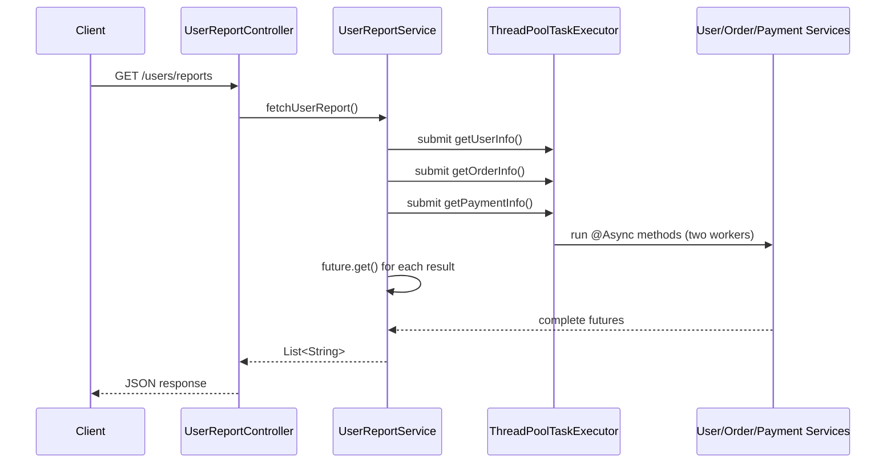

# M_18_ThreadPooling

## Project Overview

This Spring Boot exercise demonstrates how three independent service operations can be submitted as asynchronous tasks, executed by a custom `ThreadPoolTaskExecutor`, and collected into one report returned by a REST endpoint.

## Technologies Used

- Java 21
- Spring Boot 4.1.2
- Spring Web MVC
- Spring asynchronous method execution (`@EnableAsync` and `@Async`)
- Java `CompletableFuture`
- Lombok `@Slf4j`
- Maven Wrapper
- JUnit 5 and Spring Boot test support

## Project Structure

- `M18ThreadPoolingApplication` starts the application and enables Spring's asynchronous method processing.
- `ThreadConfig` defines the `ThreadPoolTaskExecutor` used by the asynchronous service methods.
- `UserReportController` exposes `GET /users/reports` and delegates report creation to `UserReportService`.
- `UserReportService` submits the three service calls, waits for their results, and builds the response list.
- `UserService` performs the simulated two-second user lookup.
- `OrderService` performs the simulated three-second order lookup.
- `PaymentService` performs the simulated four-second payment lookup.
- `M18ThreadPoolingApplicationTests` verifies that the Spring application context loads.

## Implementation Details

`M18ThreadPoolingApplication` uses `@EnableAsync`, which enables Spring to intercept calls to methods annotated with `@Async`. The methods in `UserService`, `OrderService`, and `PaymentService` are therefore submitted to the `ThreadPoolTaskExecutor` declared in `ThreadConfig` instead of running on the report request thread.

Each asynchronous method returns a `CompletableFuture<String>`. This lets `UserReportService` receive a handle to each pending result immediately after submission. The service submits the user, order, and payment operations before reading any result, allowing the configured executor to overlap their execution.

`UserReportService` calls `CompletableFuture.allOf(...)`, but it does not retain or wait on the future returned by that call. The actual waiting occurs in the following `get()` calls. Those calls add results to the report in user, order, then payment order, regardless of when each task finishes. If an exception occurs while submitting or collecting results, the existing catch block logs the exception message and returns the list accumulated up to that point.

The `Thread.sleep()` calls stand in for time-consuming user, order, and payment operations. They make the executor behavior visible without requiring external systems. Each asynchronous service logs `Thread.currentThread().getName()`, while `UserReportService` logs the request thread before and after collection and records the total elapsed time in milliseconds.

## Execution Flow

When `GET /users/reports` is called:

1. `UserReportController` invokes `UserReportService.fetchUserReport()`.
2. `UserReportService` records the start time and calls the three service methods.
3. Spring submits each `@Async` method to the configured `ThreadPoolTaskExecutor` and returns its `CompletableFuture<String>`.
4. Two tasks start on the two core executor threads. The third task is queued until a worker becomes available.
5. `UserReportService` waits at the `get()` calls, collects the three strings in a fixed order, and logs the elapsed time.
6. The controller returns the resulting list as the HTTP response.



## Thread Pool Configuration

`ThreadConfig` creates one `ThreadPoolTaskExecutor` with these values:

| Property | Value | Effect in this implementation |
| --- | ---: | --- |
| Core pool size | `2` | Two asynchronous service tasks can execute at the same time. |
| Maximum pool size | `5` | Limits the executor to five workers if it needs to expand beyond the core pool. |
| Keep-alive time | `5` seconds | A non-core worker may terminate after remaining idle for this duration. |
| Thread name prefix | `TestParallel_` | Makes executor workers recognizable in the service log entries. |

No queue capacity is set, so `ThreadPoolTaskExecutor` uses its default effectively unbounded queue. Once both core workers are occupied, additional tasks are queued rather than causing the pool to grow toward the configured maximum of five. For this project, the third service task therefore waits in the queue until one of the two workers is free; the maximum pool size and keep-alive setting do not affect this three-task execution.

## Sample Execution

The service methods are submitted in this order: user, order, payment. With two core workers:

- `UserService` and `OrderService` start first and simulate work for two and three seconds respectively.
- `PaymentService` remains queued until `UserService` finishes after approximately two seconds.
- The freed worker then runs the four-second payment operation.
- `UserReportService` first waits for the user result, then the order result, and finally the payment result. Since all tasks were submitted first, the order operation continues while the user result is being awaited.

Based on the configured executor and simulated delays, completion is governed by the queued payment path: about two seconds for the user task followed by four seconds for the payment task, plus normal application overhead. The nominal total is therefore about six seconds, rather than four seconds (which would require all three tasks to run at once) or nine seconds (fully sequential execution). This timing is derived from the code's delays and executor settings, not from a benchmark.

## Running the Application

Build the project with the Maven Wrapper:

```bash
./mvnw clean compile
```

Run the application:

```bash
./mvnw spring-boot:run
```

Test the endpoint at:

```text
http://localhost:8080/users/reports
```

## Key Takeaways

- `@EnableAsync` activates the `@Async` service methods.
- The custom executor controls how many of the three submitted operations run concurrently.
- `CompletableFuture<String>` carries each asynchronous result back to `UserReportService`.
- The report service performs the blocking waits and returns results in a defined order.
- Thread-name and elapsed-time logging make the implemented execution behavior observable.
