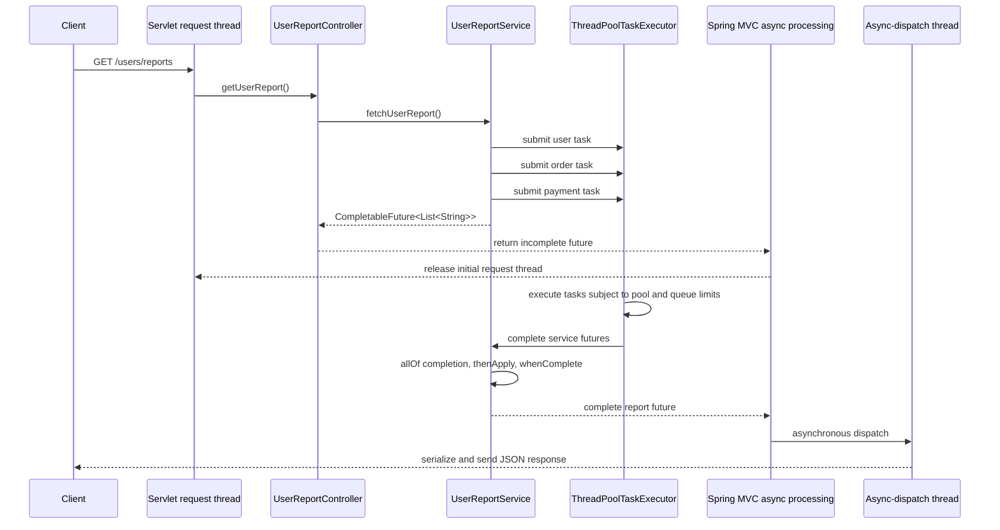

# M_18_ThreadPooling

## Project Overview

This project demonstrates the evolution of one Spring MVC endpoint from a blocking result-collection flow to asynchronous HTTP request processing based on `CompletableFuture`.

The current implementation exposes `GET /users/reports`. `UserReportService` submits three independent `@Async` operations to a custom `ThreadPoolTaskExecutor`, combines their futures with `CompletableFuture.allOf(...)`, assembles the result in `thenApply(...)`, and returns `CompletableFuture<List<String>>` to the controller. Spring MVC can then release the original servlet-container request thread while the report is being generated and perform an asynchronous dispatch when the future completes.

This history does **not** contain a version where `UserService`, `OrderService`, and `PaymentService` were ordinary synchronous methods. They used `@Async` in the first project commit. The earlier implementation was nevertheless blocking at the HTTP layer because `UserReportService` waited for those asynchronous results before returning a `List<String>`.

## Technologies Used

- Java 21
- Spring Boot 4.1.2
- Spring Web MVC
- Spring `@EnableAsync`, `@Async`, and `ThreadPoolTaskExecutor`
- Java `CompletableFuture` and `ThreadPoolExecutor`
- Lombok `@Slf4j`
- Maven Wrapper
- JUnit 5 with Spring Boot test support

## Current Project Structure

- `M18ThreadPoolingApplication` starts Spring Boot and enables `@Async` method interception.
- `ThreadConfig` defines the executor used by the three asynchronous services.
- `CustomRejectedExecutionHandler` delays and resubmits tasks rejected by the saturated executor.
- `UserService` simulates a two-second user operation.
- `OrderService` simulates a three-second order operation.
- `PaymentService` simulates a four-second payment operation.
- `UserReportService` submits the operations and composes their results without waiting for task completion on the request thread.
- `UserReportController` returns the composed future as the asynchronous MVC response.
- `M18ThreadPoolingApplicationTests` verifies that the Spring application context loads.

## Implementation Evolution

The repository contains four commits relevant to this project. The stages below are based on their actual diffs.

| Commit | Stage | Verified change |
| --- | --- | --- |
| `8b1c5e6` | Initial report implementation | Added the project, `@Async` services, a custom executor, and a controller returning `List<String>`. Report collection blocked through sequential `CompletableFuture.get()` calls. |
| `a3d6029` | Initial documentation | Added the first README. No executable code changed. |
| `05da165` | Bounded executor and retry handler | Changed maximum pool size from five to three, added queue capacity one, installed `CustomRejectedExecutionHandler`, and changed result waiting to `allOf(...).join()` followed by `get()`. |
| `a3e489d` | Asynchronous MVC response | Changed the controller and service to return `CompletableFuture<List<String>>`; replaced request-thread waiting with `allOf().thenApply(...)`; added `whenComplete(...)` failure logging. |

### Stage 1: asynchronous tasks, blocking report response — `8b1c5e6`

The first implementation already enabled Spring asynchronous method execution:

- `@EnableAsync` activated proxy-based handling of the three `@Async` service methods.
- `ThreadConfig` provided two core workers, a maximum of five workers, a five-second keep-alive time, and the `TestParallel_` thread-name prefix.
- Queue capacity was not configured, so the executor used its default effectively unbounded queue. Tasks beyond the two core workers were queued, meaning the configured maximum of five did not normally cause pool growth.
- `UserReportService` submitted all three operations and obtained three `CompletableFuture<String>` values.
- It called `CompletableFuture.allOf(...)` but discarded the returned future. That call did not wait and had no effect on the following control flow.
- It then called `get()` for the user, order, and payment futures. Each incomplete future blocked the request thread until its value was available.
- `UserReportController` returned `List<String>`, so the controller could not return until `fetchUserReport()` had finished collecting every result.

The work ran on executor threads, but one servlet-container request thread remained occupied for the entire report-generation period. This distinction is central to the later changes: asynchronous service execution alone did not make the HTTP request asynchronous.

### Stage 2: documentation — `a3d6029`

This commit added the initial README and did not change execution behavior. It documented the two-core-worker schedule and the approximately six-second single-request critical path that follows from the two-, three-, and four-second simulated operations.

### Stage 3: bounded capacity, retry, and explicit aggregate wait — `05da165`

This commit made executor saturation observable:

- Maximum pool size changed from `5` to `3`.
- Queue capacity was explicitly set to `1`.
- `CustomRejectedExecutionHandler` was registered.
- `UserReportService` changed from a discarded `allOf(...)` plus sequential blocking `get()` calls to `allOf(...).join()` followed by `get()` calls.

`allOf(...).join()` made the blocking point explicit: the request thread waited until all three futures completed successfully or the aggregate future completed exceptionally. After a successful aggregate join, the following `get()` calls normally returned immediately because the component futures were already complete. The endpoint still returned `List<String>`, so the servlet-container request thread remained occupied.

The rejection handler also introduced another possible request-thread delay. When the executor rejected a submission, the handler slept for one second on the submitting thread and tried to submit the task again. Because service submission occurred inside the HTTP request, saturation could pause that request thread before the controller had a future to return.

### Stage 4: composed result and asynchronous MVC response — `a3e489d`

The current commit changed the HTTP boundary:

- `UserReportService.fetchUserReport()` now returns `CompletableFuture<List<String>>`.
- `CompletableFuture.allOf(...)` represents aggregate completion without an immediate wait.
- `thenApply(...)` assembles the ordered report after all three tasks succeed.
- The component `join()` calls run inside that continuation, after successful `allOf` completion, so they retrieve completed values rather than creating the earlier request-thread wait.
- `whenComplete(...)` logs exceptional completion without converting it to a successful result.
- `UserReportController.getUserReport()` now returns the future directly.

Under normal executor capacity, the original request thread is used for the controller call and three task submissions, then released after Spring MVC receives the incomplete future. This changes request-thread utilization, but it does not shorten the underlying single-report critical path.

## Previous Blocking Implementation

Two blocking variants appear in the history.

### Sequential `get()` variant

In `8b1c5e6`, all three tasks were submitted before collection began. The calls then occurred in this order:

1. `userFuture.get()` waited for the user result if it was incomplete.
2. `orderFuture.get()` waited for the order result if it was still incomplete.
3. `paymentFuture.get()` waited for the payment result if it was still incomplete.

The executor tasks overlapped, but the servlet-container request thread could not return from `fetchUserReport()`. `get()` is interruptible and reports asynchronous failure through the checked `ExecutionException` wrapper. The surrounding catch block logged the message and returned whatever the list contained at that point.

### `allOf().join()` variant

In `05da165`, `CompletableFuture.allOf(userFuture, orderFuture, paymentFuture).join()` blocked the same request thread at one aggregate point. `join()` reports failure through unchecked `CompletionException` rather than checked `ExecutionException`. The later `get()` calls preserved user/order/payment result order but normally did not block again after a successful aggregate join.

Neither version prevented the asynchronous service tasks from running concurrently. Their limitation was that one request thread was retained while waiting, reducing the number of request threads available to accept or process other HTTP work.

## Current Asynchronous Implementation

The current success path is:

1. A servlet-container worker invokes `UserReportController.getUserReport()`.
2. The controller calls `UserReportService.fetchUserReport()` on that same thread.
3. The report service invokes the three Spring-proxied `@Async` methods. Each call submits work to the configured `ThreadPoolTaskExecutor` and returns a `CompletableFuture<String>`.
4. `allOf(...)` creates a `CompletableFuture<Void>` that completes after all component futures complete. It does not wait on the calling thread.
5. `thenApply(...)` creates the report stage. Because this is the non-`Async` variant, the continuation may run on the thread that completes the aggregate future; if the aggregate were already complete during registration, it could run on the registering thread.
6. `whenComplete(...)` adds success/failure observation. In this code it only logs when an exception is present and leaves the exceptional result intact.
7. The composed future returns through the controller. Spring MVC recognizes it as an asynchronous return value, starts asynchronous request processing, and releases the original request thread after the controller returns.
8. The executor workers run the service bodies. Each service logs its worker name, sleeps for its configured simulation delay, and completes its future.
9. After all three complete successfully, `thenApply(...)` reads their values in user/order/payment order with `join()`, logs the continuation thread and total report-generation time, and completes the report future.
10. Spring MVC receives the concurrent result and requests an asynchronous servlet dispatch. A servlet-container worker performs response handling and JSON serialization before the HTTP response is sent.



The custom executor is responsible for the service work. It is not the executor used for the final servlet asynchronous dispatch; that response phase still requires a servlet-container worker.

## CompletableFuture Method Comparison

The table separates methods used by this project from related Java methods that are useful for comparison.

| Method | Used where | Does the call block? | Execution and return value | Failure behavior |
| --- | --- | --- | --- | --- |
| `CompletableFuture.allOf(futures...)` | Earlier and current implementations | No | Registers aggregate completion and returns `CompletableFuture<Void>`; it does not contain the component values. | Completes exceptionally if a component future fails. |
| `future.get()` | Commits `8b1c5e6` and `05da165` | Yes, if incomplete | The calling thread waits and receives `T`. It is interruptible. | Throws checked `InterruptedException` or `ExecutionException`. |
| `future.join()` | Aggregate wait in `05da165`; component reads in the current `thenApply` | Yes, if incomplete | The calling thread waits and receives `T`. Current component joins occur after successful `allOf`, so they should already be complete. | Throws unchecked `CompletionException`; cancellation produces `CancellationException`. |
| `thread.join()` | Not used | Yes | Waits for a specific `Thread` to terminate and returns `void`. It is unrelated to `CompletableFuture.join()`. | Throws checked `InterruptedException`. |
| `thenApply(function)` | Current implementation | Registration itself does not wait for an incomplete upstream stage | Returns `CompletableFuture<U>`. The function runs on the completing thread, or may run immediately on the registering thread if the stage is already complete. | Skipped when the upstream stage is exceptional; the returned stage remains exceptional. |
| `thenApplyAsync(function)` | Not used | Registration does not wait | Returns `CompletableFuture<U>` and schedules the function on the common pool by default, or on an explicitly supplied executor. | Propagates upstream failure and captures function failure in the returned stage. |
| `whenComplete(action)` | Current implementation | Registration does not wait | Returns a stage with the same result type and invokes the action for success or failure, using non-`Async` continuation execution rules. | Observes rather than recovers from the original failure; an exception thrown by the action can also affect the returned stage. |

`thenApply()` was appropriate for the current assembly step because creating a three-element list is small and does not require a separate scheduling boundary. The repository contains no use of `thenApplyAsync()`.

## Thread Pool and Rejection Handling

`ThreadConfig` currently defines:

| Setting | Value | Practical effect |
| --- | ---: | --- |
| Core pool size | `2` | The first two tasks can start on core workers. |
| Maximum pool size | `3` | A third worker can be created after the queue is full. |
| Queue capacity | `1` | One task can wait while both core workers are occupied. |
| Keep-alive | `5` seconds | The non-core worker can be retired after five idle seconds. |
| Thread prefix | `TestParallel_` | Service log entries reveal use of this executor. |
| Rejection handler | `CustomRejectedExecutionHandler` | A rejected submission sleeps one second and is submitted again. |

For a `ThreadPoolExecutor`, submission proceeds in this order:

1. Create workers until the core size of two is reached.
2. Place the next task in the one-slot queue.
3. If the queue is full, create a third worker up to the maximum pool size.
4. If all three workers are busy and the queue is full, invoke the rejection handler.

The handler runs synchronously on the thread attempting the submission. For the three service calls, that is normally the HTTP request thread. It logs the rejection, sleeps for one second, and calls `threadPoolExecutor.submit(runnable)`. If capacity has become available, the retry is accepted. If the executor is still saturated, that submission can invoke the same handler again. The implementation has no retry counter, timeout, backoff limit, or shutdown check.

This means the current HTTP design is asynchronous while waiting for accepted service futures, but task submission itself is not guaranteed to be non-blocking under saturation. Five simultaneous endpoint calls attempt to submit fifteen tasks to one shared executor, so queueing, pool expansion, and rejection retries determine their individual response times.

## Blocking vs Non-Blocking Comparison

| Concern | Earlier `List<String>` implementations | Current `CompletableFuture<List<String>>` implementation |
| --- | --- | --- |
| Controller return | Waited for `fetchUserReport()` to return a completed list. | Returns the composed future to Spring MVC. |
| Waiting for service results | Request thread blocked in sequential `get()` or aggregate `join()`. | No result wait in the normal request path; completion is composed with `thenApply()`. |
| Request-thread occupancy | Held for approximately the full report-generation duration. | Released after successful task submission and future registration. |
| Saturated submission | In the rejection-handler stage, the request thread could sleep during retry. | The same caveat remains before the future is returned. |
| Single-request service latency | Determined by the executor schedule and simulated delays. | Essentially the same critical path; asynchronous MVC does not make the service tasks faster. |
| Concurrent HTTP requests | Waiting reports consumed request threads. | Waiting reports normally do not retain their initial request threads, but all reports still share the small service executor. |
| Response processing | Performed before the synchronous controller call returned. | Requires a later asynchronous dispatch and an available servlet-container worker. |
| Failure handling | Caught in `UserReportService` and returned a possibly empty or partial list. | Exceptional completion is logged and remains available to Spring MVC for HTTP error processing. |

The current design primarily improves servlet request-thread utilization. Its throughput and response latency remain bounded by the three-worker executor, one-slot queue, simulated task durations, retry policy, and final servlet dispatch capacity.

## Execution Timeline and Logs

For one request against an otherwise idle executor, the code implies this schedule:

| Approximate time | Executor state |
| ---: | --- |
| `0s` | User task starts on core worker 1; order task starts on core worker 2; payment task enters the one-slot queue. |
| `2s` | User task completes. Its worker takes the queued payment task. |
| `3s` | Order task completes. |
| `6s` | Payment task completes after running for four seconds; the aggregate future can now complete and assemble the report. |

The maximum pool size of three is not reached for this isolated request because the third task fits in the queue. The critical path is therefore the two-second user task followed by the queued four-second payment task, producing a nominal report-generation time of about six seconds plus scheduling overhead.

The six-second figure is an execution consequence of the current delays and an otherwise idle executor, and it matches the behavior documented in `a3d6029`. The Git history does not contain captured console output or a benchmark, so exact timestamps and thread suffixes are not reproduced here. Under concurrent requests, prior work may already occupy the workers and queue, so the timeline can be longer and the task order can differ.

The existing logs expose:

- The request thread entering `UserReportService`.
- The executor worker used by each service operation.
- The thread that executes the `thenApply()` report assembly.
- Total time from entry into `fetchUserReport()` through report assembly, including submission delays, queueing, and service execution, but excluding final HTTP dispatch and response transmission.
- Rejection and retry attempts from `CustomRejectedExecutionHandler`.

## Limitations and Caveats

- **Exceptional service completion:** If any component future fails, `allOf(...)` completes exceptionally, `thenApply(...)` is skipped, and `whenComplete(...)` logs the failure. Because `whenComplete(...)` does not recover, Spring MVC receives an exceptional future.
- **Synchronous submission failure:** A failure thrown while one of the three `@Async` calls is being submitted occurs before the composed future is returned. In that case, the later `whenComplete(...)` stage is never registered for the failed request, and normal synchronous MVC exception handling applies.
- **Submitting-thread delay:** The rejection handler sleeps on the caller. During endpoint submission this can retain a servlet-container worker even though the controller's declared return type is asynchronous.
- **Unbounded retry behavior:** A retry that is rejected can re-enter the same handler. There is no fixed attempt limit or special handling for executor shutdown.
- **Interrupted retry:** The handler converts `InterruptedException` to `RuntimeException` and does not restore the interrupted flag.
- **Executor bottleneck:** All HTTP requests share three service workers and one queue slot. Returning a future does not increase that capacity.
- **MVC asynchronous timeout:** No application-specific asynchronous request timeout is configured. The effective framework/container timeout can expire before a heavily queued or repeatedly retried report completes. Timing out the HTTP request does not automatically guarantee that already-submitted executor work stops.
- **Final response dispatch:** Future completion does not itself write the response. Spring MVC performs an asynchronous dispatch, which can be delayed if no servlet-container worker is available.
- **Continuation thread:** Non-`Async` `thenApply()` and `whenComplete()` do not select a dedicated executor. Their actions normally run on the thread completing the preceding stage, but the API does not guarantee one named application thread.
- **Declared interruption:** `fetchUserReport()` and the controller still declare `InterruptedException`, although the current composition does not directly wait in those methods. Their signatures are preserved as part of the existing implementation.

## Running and Testing

Compile with the Maven Wrapper:

```bash
./mvnw clean compile
```

Run the application:

```bash
./mvnw spring-boot:run
```

Call the endpoint:

```bash
curl -i http://localhost:8080/users/reports
```

Send five requests concurrently from a shell:

```bash
for request_id in 1 2 3 4 5; do
  curl -sS -w "\nrequest ${request_id}: HTTP %{http_code}, %{time_total}s\n" \
    http://localhost:8080/users/reports &
done
wait
```

The concurrent test intentionally exceeds the small executor's immediately available capacity. It can demonstrate queueing and rejection retries, but the exact ordering and duration depend on thread scheduling and executor state at the start of the test.

## Key Takeaways

- `@Async` moved the three simulated operations to a dedicated executor from the first project commit, but the original `List<String>` response still blocked the request thread while collecting results.
- `allOf()` represents aggregate completion; only `get()` or `join()` introduces a blocking wait when called on an incomplete future.
- Replacing `allOf().join()` with `allOf().thenApply()` enabled completion-based composition instead of request-thread waiting.
- Returning `CompletableFuture<List<String>>` allowed Spring MVC asynchronous request processing, while still requiring a later servlet dispatch to produce the HTTP response.
- The custom rejection handler demonstrates saturation behavior, but its sleep-and-resubmit policy can block request threads and retry repeatedly.
- Asynchronous HTTP processing improves request-thread utilization; it does not remove executor limits or reduce the approximately six-second isolated-request critical path.
